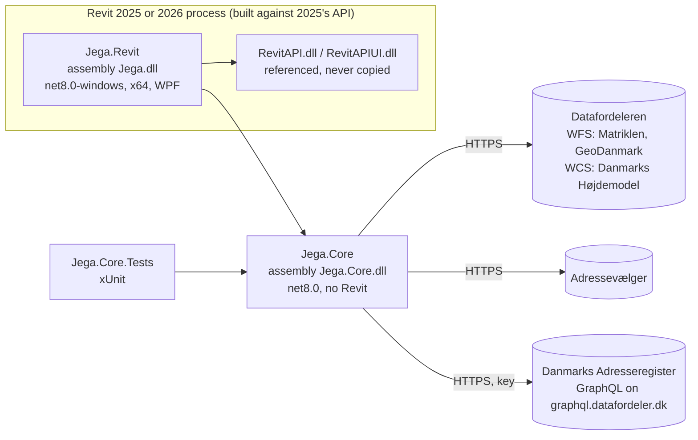
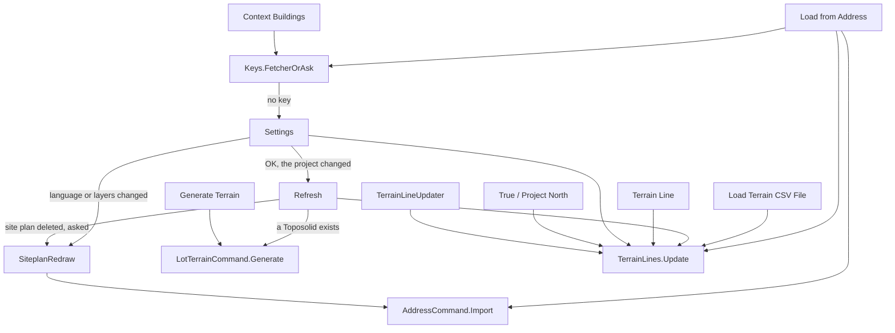
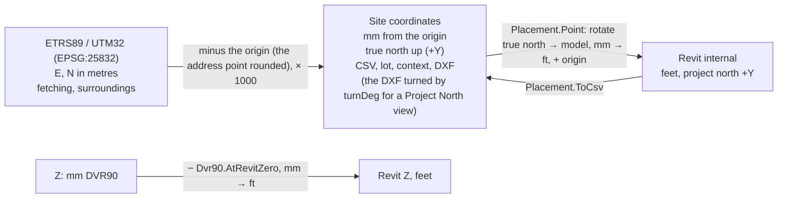
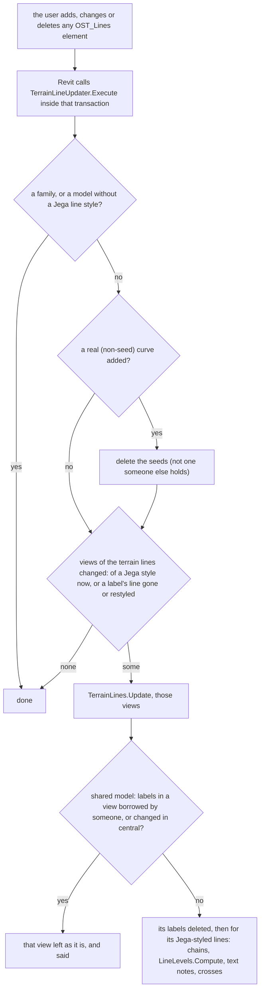

# Jega architecture

For the people who maintain Jega: how it is built, where things live, and what must not be broken. File references are
paths under `src/`; line numbers are left out on purpose, so the document doesn't go stale with every edit.

Contents: 1 Projects · 2 Source map · 3 Commands · 4 From address to Toposolid · 5 What is stored where ·
6 Coordinates and elevations · 7 Texts · 8 Transactions, Undo and the updater · 9 Build, test, deploy ·
10 Invariants · 11 Pitfalls and known limits

---

## 1. Projects



| Project | Target | Depends on | Holds |
|---|---|---|---|
| `src/Jega.Core` | net8.0 | the .NET base library only (`HttpClient`, `System.Text.Json`, `System.Xml.Linq`) | everything that runs without Revit: address search, fetching, the terrain grid, elevations along edges and lines, the Toposolid's points, the site plan DXF, the settings records, `Config` |
| `src/Jega.Revit` | net8.0-windows, x64, WPF | Jega.Core; RevitAPI and RevitAPIUI from `$(RevitDir)` with `Private=false` | the ribbon, the commands and windows, the site's place in the model, storage in the model, the updater |
| `tests/Jega.Core.Tests` | net8.0 | Jega.Core, xUnit | the tests of Core; `Data/` holds the test case's real terrain, context and surroundings, and its four golden DXFs; the test case is Skagens Museum, Brøndumsvej 4, 9990 Skagen |

- **No NuGet packages** outside the test project.
- **Both `src` projects** have `Nullable` and `TreatWarningsAsErrors` on.
- **Jega.Revit** also has `EnableDynamicLoading` on, and it turns MSB3277 into a message, because Revit's own
  System.Drawing sits beside .NET's.
- **The rule that keeps it testable:** Jega.Core never references Revit. Whatever can be computed without Revit belongs
  in Core, where it is tested. Jega.Revit converts between Core's world (mm, site coordinates, true north up) and
  Revit's world (internal feet, project north).

---

## 2. Source map

### Jega.Core

| File | Responsibility |
|---|---|
| `SiteFetcher.cs` | All network I/O. Adressevælger: search and address point; once it is left (`AddressFallback`), the register's instead: `SearchRegister` (DAR_Husnummer by prefix, status 3, one page of 100: `AllNodes(…, only: 100)`) and `RegisterPoint` (DAR_Husnummer by id, then its DAR_Adressepunkt's position), with `AddressFallbackNote` (`Fetch_AddressFallback`) for the address window and the receipt. `Now` gives every DAR query its `virkningstid` and `registreringstid`. Datafordeler WFS 2.0 (GML 3.2): `lots`, `buildings`, `roads`, `water`, `manholes`, `gullies`, `trees`, `treeGroups` (tree groups and woods in one call), `hedges`; `ParseGml` reads `gml:posList` and `gml:pos`, a point (a manhole cover, a gully) as a ring of one point with its level as the property `z`. Danmarks Adresseregister on Datafordeleren's GraphQL (`DarUrl`, the same key as `apiKey`): `Addresses` runs three queries, each paged (`AllNodes`): the address points in the box, their current house numbers (status 3, at most 100 ids per `in` list, `InListMax`), then the streets with their name lines; `ParseAddresses` joins them (the WKT through `WktLines`) into `HouseNumber`s, each with its street, address point, GeoDanmark building and the street's name line. WCS 1.0 (float32 GeoTIFF): `dhm_terraen`, `dhm_overflade`, fetched in parts of at most `MaxCellsPerCall` cells a side, `ParallelParts` at a time. Load from Address takes terrain and surface once, over the context's box (`HeightMargin`: lot + 40 m, less on a large lot so it never takes more parts than the terrain alone, nor more than `MaxPoints`), and cuts the terrain CSV (lot + 5 m) from it (`Crop`); the roofs on the lot (`Roofs`) come from the same two grids, and the context JSON too when they are as good as `FetchContext`'s (`ContextFromFetch`: the whole 40 m at `ContextCell`; else none is kept); without the surface the load goes on without them and says so. Every layer round the lot is optional (`Optional<T>`): a failed call leaves it out and the receipt says which (`Site.NoLots`, `NoBuildings`, `NoRoads`, `NoWater`, `NoManholes` for the covers or the gullies, `NoAddresses` for the street names and house numbers, `NoVegetation` for the trees, tree groups or hedges; `NoSurface` for the surface, then no roofs or context either). Only the lot itself and the terrain stop the load. A layer whose drawing fails is left out too (`SiteplanDxf.WriteWithReport`), named in `Site.SkippedLayers`. Without the lots the lot is drawn alone, without number or area; without the buildings none are drawn, and no roofs or context. The CSV, the lot and the context are measured from the project's origin (`ProjectOrigin`), which is also the DXF's 0,0. `FetchContext` for Context Buildings' Shift+click, or when the load kept none. Minimal GML and GeoTIFF readers, the terrain CSV, the house ground, Test key. One `HttpClient`: the Windows login for a proxy that asks (`DefaultProxyCredentials`), `User-Agent` `Jega/<version>`, 30 s. HTTP 407 is the network's, 401/403 the key's (or Adressevælger's token), each with its own message. A server error, no answer or 429 is tried twice more (`Retry`). Every failure is a `FetchException` whose message is for the user, with the HTTP status (`Status`) or `NoAnswer` when the service didn't answer after the retries. `Credit` is the data credit |
| `ProjectOrigin.cs` | The project's origin (*nulpunkt*): the address point rounded to whole metres (UTM32), the site's 0,0 |
| `AddressSearch.cs` | Ranking and retries around Adressevælger's search: streets fill in and wait for the house number, then a retry with the street and postcode (a number the street doesn't have there), then with fewer words. The fallback's search in the register: `Register` puts the typed text in the register's form (the street with capitals, also after a dot or hyphen, `Capital`; "af", "ved", "til", "i", "og" small; a word-final dot tried kept and dropped) as prefixes "Street nr," and "Street nr" (the street alone without a number); `RegisterHits` keeps the typed number and its letters ("1": 1 and 1A, not 10); `SearchRegister` sorts them with `Pick` on the typed words, so the town wins without its postcode. No network; the calls are injected |
| `AddressFallback.cs` | Which service the address field and the chosen address's point go to: Adressevælger first; at its first 400 (a token it doesn't know), 401, 403, 404 or no answer (`FetchException.Status`/`NoAnswer`; never a cancel, an unreadable answer, a 500 or the proxy), Danmarks Adresseregister on Datafordeleren's GraphQL with the key, for the rest of the `SiteFetcher`'s life (one Load from Address), so a keystroke costs no failed call first. `Reason` is the status or "timeout"; `Note` takes the warm-up's failure. No network |
| `TerrainGrid.cs` | The one reader of the terrain CSV. Validates a complete, regular grid without duplicates; bilinear `ElevationAt`. `TerrainGridException` |
| `EdgeSampler.cs` | `Point2`, `EdgePoint`: points along a closed ring, every corner plus steps of at most 400 mm |
| `EdgeLevels.cs` | Elevations along a closed ring (the lot boundary): every point, highest, lowest, span |
| `LineLevels.cs` | Elevations along an open or closed chain of pieces (Terrain Line): a value at every vertex, fall and slope per piece, highest and lowest |
| `LotTerrain.cs` | `Point3`, the Toposolid's points: edge samples plus thinned grid nodes inside, holes left out, kept clear of the edge. `LevelAt` for the "Terrain" level and the terrain point choices |
| `SiteplanDxf.cs` | The site plan as DXF R12 text, drawn in one flow (§4, step 6; `WriteWithReport` returns the layers left out), turned for the view it stands in (`turnDeg`, `SiteplanRedraw.TurnFor`: degrees counter-clockwise about the drawing's 0,0, also on `Surroundings.SitePlan`: all content is turned before it is drawn (`Drawing.Turn`), the frame is worked out from the turned lot with the same margin, the north arrow turns with it, the terrain is looked up with the turn undone (Geo/Z), the notes give the unturned UTM numbers plus a note of the turn (`Drawing_Turned`), and the terrain on the lot is worked out from the unturned lot; 0 = north up, the golden files unchanged, `skagens-museum-siteplan-turned.dxf` at 30°): layers, clipping, boundary lengths, spot elevations, the roofs' ridge and eaves (`TAGKOTER`), GeoDanmark's manhole covers (`BROENDE`, a 1.6 mm circle) and road gullies (`RISTE`, a 1.2 mm square) with their levels and a note that utilities are not shown and are obtained from LER before excavation (LER Act § 7), the neighbours' house numbers (`HUSNUMRE`: in the building the address belongs to, one height for all with `Label.Spots` and `Label.Even` as the roofs; several as "12, 14", over three as "2-16"; no building or no room: at the address point; the lot's own address left out) and street names (`VEJNAVNE`: once per street along the longest piece of its name line in the window, turned with it, `Label.Upright`), GeoDanmark's trees (`TRAEER`: a 2 mm circle with a dot; tree groups and woods as outlines) and hedges (`HEGN`, lines), setback line, the cross at 0,0 (`ADRESSEPUNKT`; `NULPUNKT` when the origin is apart from the address point, which then gets a small cross on `ADRESSEPUNKT`, and the note gives both: the origin in whole metres, the address point with mm), legend, scale bar and notes, in the language it is given (`Drawing_*`). Its geometry and text fitting are in `Util/Geometry.cs` and `Util/Label.cs` |
| `SiteplanLayers.cs` | The DXF's layer names, Danish and the same in every language |
| `Surroundings.cs` | What was fetched around the lot, as JSON (version 1, UTM32 m), with the roofs on the lot as numbers (`roofs`, missing in older ones) and the manhole covers and gullies (`manholes`, `gullies`, each with `z`; missing = none, as `water`) and the house numbers (`addresses`: number, street, point, building, name line; missing = none) and the trees, tree groups and woods, and hedges (`trees`, `treeGroups`, `hedges`; missing = none), so the DXF can be drawn again for another area without fetching |
| `Context.cs` | Reads the context JSON (version 1) into `ContextBuilding`s. Anything it can't read, damaged fields too, is a `ContextException` |
| `Build.cs` | `Build.Version`, this build's version from `Directory.Build.props` (e.g. `0.9.0-beta.1`), written into the stored JSON as `writtenBy` |
| `ProjectOptions.cs` | The project's settings record, stored as JSON in the model. Missing fields take their defaults; stored names no longer used are passed over. `Problems()` validates them for the Settings window. `SiteplanPaperStraight` (default true): the site plan's paper straight in its view, only the map turning (`SiteplanRedraw.TurnFor`); off, the whole plan turned as one |
| `MachineOptions.cs` | This PC's settings, `%APPDATA%\Jega\settings.json`: the protected key and the Adressevælger token. Saved atomically (`.part`, then a move) |
| `Config.cs` | `Config.Current`: names, looks and limits in one place (line styles, types, DXF layers and colours, fetch margins and limits, default steps, the languages and the default one, Danish). Code only today; meant to become a file |
| `Language.cs` | The language Jega speaks (`Current`, a culture from `Config.Languages`): Core's texts and how numbers are shown. Set by the host; invariant until then, as in the tests |
| `Texts.cs` | `Fill`: Core's texts with their values filled in, numbers in the language spoken (`Texts.Numbers`) |
| `Util/Retry.cs` | Whether a failed call is tried again and after how long: server error, no answer, 429 (Retry-After, at most 5 s); three tries |
| `Util/HeightCells.cs` | The height model's 0.4 m cells: valid heights, cell centres, snapping boxes to whole cells |
| `Util/Angles.cs` | Degrees and radians |
| `Util/Geometry.cs` | Plane geometry in metres (`Pt`): inside, area, centre, label point, lot centre, offset ring, the setback line, trimmed at notches and short edges (`Setback`), the least turned box (`LongBox`), a ring less what it shares (`Unshared`), clipping |
| `Util/Label.cs` | Text fitted into a shape: `Spots` (along its long side or level, clear of what to avoid), `Even` (one height for many, so the plan is even), `Strip` (a road parcel), and text boxes (`Bounds`, `Overlap`, `Upright`). Used for the roof levels and the parcel numbers |
| `Resources/Strings.resx`, `Strings.da.resx` | Core's user-facing text, English and Danish, the drawing's (`Drawing_*`) too (§7) |

### Jega.Revit

| File | Responsibility |
|---|---|
| `App.cs` | `IExternalApplication`: the "Jega" tab with four panels: Site (Load from Address as a split button with Load Terrain CSV File under it, Refresh, Layers, and Work Direction and True / Project North small and stacked), Model, Terrain Elevations, Jega; registers the updater; `Relabel` for a change of language |
| `AddressCommand.cs` | Load from Address: the address window (`AddressWindow`, search and fetching off Revit's thread), the large-lot choice (`GridChoice`), the choice for a project with coordinates of its own (`ExistingCoordinates`), the new-address choice (`NewAddressUtm`: keep the project's origin, offered while the address fits within 10 km of the internal origin (`Placement.Fits`); move the origin to the new address; Manual georeference when it doesn't fit; the distance from the current address said, m to 2 km, km beyond; `NewAddress` under Manual georeference), and `Import` (also used by the redraw) |
| `UpdateTerrainCommand.cs` | Load Terrain CSV File |
| `RefreshCommand.cs` | Refresh. `Run` is also called by Settings' OK and by `JegaCommand` (§3). `PlaceByCoordinates` puts the import back on its real coordinates |
| `LotTerrainCommand.cs` | Generate Terrain. `Generate` is also called by Refresh. The "Terrain" level, the Toposolid type, the fingerprint, keep / move / rebuild, and the height check (`Deviation`) |
| `LotEdgeCommand.cs`, `EdgeRegions.cs`, `ResultWindow.cs` | Draw Lot Boundary: the filled region and its type, and the window with the boundary's elevations and the offset |
| `TerrainLineCommand.cs` | Terrain Line: the line styles, the first-run dialog, the seed line and Create Similar |
| `TerrainLines.cs` | All terrain line labels (text notes and crosses) and their text type: `Update(doc, views)` for some views or all, the chains (`Chains`, each piece keeping its line), each label marked with the lines of its pieces (`JegaLabelLines`), and `Held` for shared models (§8.3) |
| `TerrainLineUpdater.cs` | The `IUpdater` that keeps the labels up to date, only in the views where a terrain line changed (`Views`, §8.3) |
| `CrossSymbol.cs` | Makes the "Jega Cross" generic annotation family from Revit's template into `%APPDATA%`, with a fixed-size fallback, and loads it |
| `ContextCommand.cs`, `ContextMasses.cs` | Context Buildings: on, off and fetch again (Shift+click), the waiting window, the DirectShape masses |
| `SettingsCommand.cs`, `SettingsWindow.cs` | The Settings window (five tabs and the language, built in code) and applying it, then Refresh |
| `LayersCommand.cs` | Layers in the ribbon: Settings opened on its Layers tab |
| `SiteplanRedraw.cs` | Draws the DXF again from the stored surroundings and imports it: when Settings changes the language (asked first) or the layers, roof levels, margin or setback (unasked), and, from the frame, a deleted site plan at Refresh (`FromFrame`, asked first). `TurnFor(options, target, view)` is the turn for the view the plan stands in: `target.AngleToTrueNorth` in Project North, 0 in True North (`IsTrueNorth`), so its frame, texts and legend lie straight there; 0 with `SiteplanPaperStraight` off (the whole plan turned as one, its frame round the lot north up); `Draw` draws the DXF from what is stored with that turn; Load from Address draws it again with it once the target is known (`AddressCommand.ImportSiteplan`), over the north-up one the fetch drew. `Unfitting(doc, options, old)`: the view, place and turn when the import's stored turn doesn't match `TurnFor` for its view (≥ 0.01°), else null; `Straighten` (Refresh after `Remember`, and `ViewNorthCommand` after switching the orientation) then draws it again there, same place and north (`Refresh_Straightened`), and `Placement.Stale` counts it, so the next command that places by the frame Refreshes first |
| `ExportCommand.cs` | Export: the DXF and the CSV from the model (read-only) |
| `AboutCommand.cs`, `BuildInfo.cs` | About: licence, credit, and the build (version and time; the source folder in Debug builds) |
| `Placement.cs` | **The site ↔ model transform**: the frame, the landing (real coordinates, or Manual georeference's anchor), the project's origin (`Origin`, `MoveOrigin`), georeferencing, `Remember`, `Stale`, moving the site (`MoveSiteTo`). `NorthOf(import)` is the site's north: the import's `Transforms.NorthAngle` plus the turn its drawing was given (`JegaSiteplanTurn`); `Remember`, `Stale`, `MoveSiteTo` and `SiteplanRedraw` read the import's north there (`AddressPointOf` for its place). `AddressCommand.Import(…, drawnTurnDeg)` turns the import that much less and writes the turn on it |
| `ViewNorthCommand.cs` | True / Project North: the active plan view's Orientation (`PLAN_VIEW_NORTH`) switched, the site plan drawn again for it when it stands in that view (`SiteplanRedraw.Straighten`), and that view's labels made again; one Undo, silent unless a view template holds the orientation |
| `WorkDirectionCommand.cs` | Work Direction: posts Revit's Rotate Project North (the whole model turns; Jega turns nothing itself), then waits on Revit's `Idling` (`AfterRotate`) until the project's true north has changed and runs Refresh (its own Undo; quiet unless it has a problem), so the site plan's paper is straight again at once; a Jega command, another document or the Refresh stops the wait (`Disarm`, also called at the top of `JegaCommand.Execute`), so a cancelled rotation never Refreshes later. In a True North view it says to switch first, as Revit would do nothing |
| `LotOutline.cs` | The lot's outline and holes in model coordinates: from the stored site, else from a `GRUND` layer in an import |
| `GridFrameWriter.cs` | The dashed frame round the terrain grid (detail lines, style "Jega Grid") |
| `LineStyles.cs` | Jega's line styles (subcategories of Lines) and the dash pattern |
| `ProjectStore.cs` | **Everything kept in the model** (Extensible Storage) and the element marks (§5.1) |
| `Dvr90.cs` | The DVR90 of Revit's 0, and how it is described in receipts |
| `Receipts.cs` | Receipt pieces several commands share: the terrain's numbers, the floor line, the credit |
| `Secret.cs` | DPAPI protect and unprotect of the key |
| `Icons.cs` | The ribbon icons, drawn in code |
| `Util/Ui.cs` | The WPF building blocks, `Fill`, `Receipt` with `ReceiptText`, and `Failed` (a command stopped unexpectedly) |
| `Util/Units.cs` | **mm ↔ feet**, the only place they are converted; number formatting (`Numbers`, `Level`, `Metres`) |
| `Util/ProjectLanguage.cs` | The project's language (Settings) made the one spoken: both resx, the numbers, the ribbon (`Apply`, `Use`, and `Try` for a change that may not be saved; §7) |
| `Util/JegaCommand.cs` | The base of every command but About: the project's language first, a warning once for a read-only file, a Refresh when the command places by the frame and the import moved since (`UsesFrame`), then `Run`; an unforeseen failure to the log and `Ui.Failed` (§3) |
| `Util/ProjectOnly.cs` | The buttons' availability: `ProjectOnly`, `WritableProject`, `PlanViewOnly`, `Always` (§3) |
| `Util/JegaLog.cs` | `%APPDATA%\Jega\jega.log`: unforeseen failures, what the updater or a view switch couldn't show, and notes for a report; with the Jega and Revit versions, under 1 MB |
| `Util/Keys.cs` | A `SiteFetcher` from this PC's key, or the "needs your key" dialog that opens Settings |
| `Util/StoredTerrain.cs` | The stored CSV as a `TerrainGrid`, kept by its stamp (the document, its DataStorage, `ImportedUtc`), so the CSV is taken out of the model only after a new terrain |
| `Util/Transforms.cs` | The north angle of an import transform, and whether it is mirrored |
| `Util/Inherited.cs` | What an element made again (the Toposolid, the context masses, the site plan import) takes over from the one it replaces: its workset and phases. The first one goes where Revit puts it |
| `Resources/Strings.resx`, `Strings.da.resx` | All user-facing text on the Revit side, English and Danish (§7) |

`tools/ClearKey.ps1` (with `ClearKey.cmd` and `RestoreKey.cmd`) takes the key out of `settings.json` and puts it back,
to test the first-run flow. `tools/LiveBatch.ps1` fetches every address in `tools/live-addresses.txt` (git-ignored)
through `Any_address_to_files` and draws each plan to PNG with `tools/RenderDxf.ps1` (a DXF to PNG, no CAD needed).

---

## 3. Commands

All commands are `TransactionMode.Manual`, except Export and About, which are `ReadOnly`. Every command first applies
its project's language (`ProjectLanguage.Apply`, §7). Every command but About derives from `JegaCommand`
(`Util/JegaCommand.cs`), whose `Execute` applies the language, titles the command's dialogs with its button's name
(`Ui.Title`, `Button`) and then calls the command's `Run(data, doc)`. A command
that places by the frame (`UsesFrame`: Load Terrain CSV File, Generate Terrain, Draw Lot Boundary, Context Buildings,
Terrain Line, Settings and Layers) is Refreshed first when the site plan import has moved or turned since the frame was
kept (`Placement.Stale`: by `Remember`'s tolerances, no geometry; a new work direction is the usual cause). Quiet when
that went well (its own Undo, "Refresh"); Refresh's receipt first, headed `Refresh_First` (`Refresh_FirstShared` under
real coordinates), when it has a problem; the command doesn't run when Revit stopped Refresh. A failure `Run` doesn't
catch itself goes to `JegaLog` and `Ui.Failed` (what it was, the log's path as `%APPDATA%\…`, so a screenshot shows no
user name, and a button that opens its folder), and the command returns `Cancelled`, never out into Revit's own
dialog. Revit's `OperationCanceledException` (Esc in a pick) is `Cancelled` without a message. About needs no
document and stays a plain `IExternalCommand`.

The availability classes are in `Util/ProjectOnly.cs`. Export has `ProjectOnly`: greyed out with no document open and
in the family editor. Work Direction and True / Project North have `PlanViewOnly`: also greyed out when the active view
isn't a plan. The other buttons have `WritableProject`, for now the same as `ProjectOnly`: `doc.IsReadOnly` there
greyed them out in an ordinary project in Revit 2025. A file opened read-only is warned about once, before the first
command that writes (`ReadOnly_Warning`). What a model that really is read-only (a cloud model with view rights only)
does is untried: a failure there goes through `JegaCommand` like any other, to the log and `Ui.Failed`. About has
`Always`, so it can be opened before any project.

| Button | Class | Needs | Writes in the model | Undo |
|---|---|---|---|---|
| Load from Address | `AddressCommand` | a plan view with a level; a key | the site, the frame, the terrain, the surroundings, the import and its origin, the grid frame, the cross family, the labels, the context (from the same calls, when as good as Context Buildings' own; an old address's masses go); real coordinates in a project without them (or over its own, if asked); a new address may move the project's origin; Manual georeference turned on when the address doesn't fit the project's coordinates | 1 (group) |
| Work Direction | `WorkDirectionCommand` | a plan view in Project North (`PlanViewOnly`) | nothing itself: posts Revit's Rotate Project North | Revit's |
| True / Project North | `ViewNorthCommand` | a plan view (`PlanViewOnly`) | the active view's Orientation, switched, and its labels made again; silent unless a template holds the orientation | 1 |
| Load Terrain CSV File | `UpdateTerrainCommand` | a plan view with a level | the terrain, the grid frame, the cross family, the labels | 1 |
| Refresh | `RefreshCommand` | a stored terrain | a deleted site plan drawn again (asked first); under real coordinates the import put back on them (`PlaceByCoordinates`); the frame, the grid frame, the labels, the context masses if shown, the Toposolid if there is one. Never true north or the elevation of Revit's 0 | 1 (group) |
| Generate Terrain | `LotTerrainCommand` | a terrain, a lot, and a Toposolid type to copy | the Toposolid, the "Terrain" level with its plan view and level heads, the "Jega Terrain" type | 1 (2 when it first follows a moved site, then moves up or down or is made again) |
| Draw Lot Boundary | `LotEdgeCommand` | a plan view with a level, a terrain, a lot | the filled region and its type; the offset, if changed in the window | 1, or 2 with the offset |
| Context Buildings | `ContextCommand` | a site from Load from Address; a key only for Shift+click or without a stored context (a large lot, a coarser grid, no surface) | the context JSON (when fetched), the masses | 1 |
| Terrain Line | `TerrainLineCommand` | a plan view, a terrain | the line styles, the cross family, its plan's labels, a seed line | 1, then the user's own drawing |
| Settings, Layers | `SettingsCommand`, `LayersCommand` (on the Layers tab) | nothing | the options, the language too; optionally a redrawn site plan, real coordinates given or put back, the site moved to a new anchor, the DVR90 of Revit's 0 (the shared elevation, or `FloorDvr90Mm`), the cross and text sizes; then Refresh, unless only the drawing changed | 1, Refresh's inside |
| Export | `ExportCommand` | a terrain | nothing (writes two files) | 0 |
| About | `AboutCommand` | nothing | nothing | 0 |



What each one calls, on its main path:

- **Load from Address:** `Keys.FetcherOrAsk` → `AddressWindow` (`SiteFetcher.SearchAddress`, `AddressPoint`, `Lot`,
  `PlanTerrain` and `GridChoice`, `Fetch` with the origin `ProjectOrigin.Of`, which draws the DXF in the language
  spoken and dates the surroundings, `TerrainGrid.Parse`) → a new address: `NewAddressUtm` (real coordinates) or
  `NewAddress` (Manual georeference); the first site in a project with coordinates of its own: `ExistingCoordinates` →
  the DXF to a temp folder → `CrossSymbol.Prepare` → one group:
  - [Site] `ProjectStore.WriteSite`, the options' anchor (Manual georeference turned on), `ContextMasses.Remove` and
    `ClearContext` (new address), `WriteContext` (the context from the same calls), `RefreshCommand.PlaceByCoordinates`
    and `Placement.Remember` (same address), `Placement.MoveOrigin` (a new address that moves the origin),
    `Placement.Georeference` (real coordinates, when the project hasn't them, or Jega's set over its own); the target:
    `Placement.Shared` (real coordinates), else `Landing` (a new address started afresh, `ForgetHold`), else a nearby
    new address (within 2 km, `NearbyM`) kept where it was at its true offset from the frame, else the frame; `HoldHere`
    (a new address kept where it was)
  - [Import site plan] `Import`: the old import and its CAD type deleted, `doc.Import` (Origin to Origin, mm,
    `OrientToView` and `AutoCorrectAlmostVHLines` off, the view in Project North while it imports), rotated and moved
    from where it landed onto the target, marked (with its owner), its 0,0 recorded, the setback layer dashed
  - [Load terrain] `WriteFrame`, `WriteTerrain`, `WriteSurroundings`, `GridFrameWriter.Draw`, `CrossSymbol.Load`,
    `TerrainLines.Update`
- **Load Terrain CSV File:** file dialog → `TerrainGrid.Parse` → `CrossSymbol.Prepare` → `WriteTerrain`,
  `GridFrameWriter.Draw`, `CrossSymbol.Load`, `TerrainLines.Update`.
- **Refresh:** `StoredTerrain.TryGet` → the redraw question (a deleted site plan, once per model per session) →
  `CrossSymbol.Prepare` → one group: [Refresh] `SiteplanRedraw.FromFrame` (if yes), `PlaceByCoordinates` (real
  coordinates), `Remember`, `GridFrameWriter.Draw`, `CrossSymbol.Load`, `TerrainLines.Update`, `ContextMasses.Build`
  (if shown) → `LotTerrainCommand.Generate` (if a Toposolid exists).
- **Generate Terrain:** `StoredTerrain.TryGet` → `LotOutline.Find` and `Holes` → `LotTerrain.Compute`, `LevelAt` →
  the fingerprint (`Inputs`) → keep (record or move: `Keep`, `LevelTo`), or follow a moved site (`Follow`, turned and
  moved rigidly, its own transaction), or, asked first when a hand-edited shape or what hangs on it (tags, dimensions,
  hosted families, sub-Toposolids) would be lost (`AskBeforeRemaking`; "Keep the old one" ends with `Generate_KeptOld`),
  rebuild: delete the old one (Jega's own, not a copy), `TerrainLevel`, `TerrainType`, `Toposolid.Create`, `Deviation`,
  `LevelTo`, `Mark`, `WriteBuilt`. If Revit refuses it with holes, it rolls back and tries again without them.
- **Draw Lot Boundary:** `StoredTerrain.TryGet`, `LotOutline.Find` → `EdgeRegions.FindType` or `CreateType`, delete
  the old region, `FilledRegion.Create` (with holes, else without) → `ResultWindow` (`EdgeLevels.Compute`) →
  [Offset] `ProjectStore.WriteOffset`.
- **Context Buildings:** shown and no Shift: [off] `ContextMasses.Remove`. Otherwise `ReadContext` (kept by Load from
  Address), or (Shift+click, or none kept) `Keys.FetcherOrAsk` → `FetchWindow` → `SiteFetcher.FetchContext` →
  `Context.Parse` → [on] `WriteContext`, `ContextMasses.Build`.
- **Terrain Line:** `StoredTerrain.TryGet`, `CrossSymbol.Prepare` → [Terrain Line] `CrossSymbol.Load`, the two line
  styles, `RemoveSeeds`, `TerrainLines.Update` of its own plan, a seed detail line when the plan has no elevations-only
  line yet → `PostCommand(CreateSimilar)` on it.
- **Settings:** reads everything → `SettingsWindow` → the redraw question (language changed), the coordinates question
  (back to real coordinates in a project whose coordinates aren't the site's own, `OnOwnCoordinates`: Load from
  Address's `ExistingCoordinates`, follow them where they fit or set Jega's), the put-back question (leaving real
  coordinates Jega gave) and the links question (a new floor elevation with links) →
  `ProjectLanguage.Try` (the chosen language spoken; back if not saved) → `MachineOptions.Save` (outside any
  transaction) → [Settings] `WriteOptions`, `SiteplanRedraw.Run`, `MoveToNewAnchor` (`Georeference`, forced when
  Jega's were chosen over the project's own, putting
  coordinates back, `ForgetHold`, `MoveSiteTo` to `Landing`: the site's own turn kept under Manual georeference, the
  coordinates' north under real ones), cross and text size, `SetRevitZero` (the shared elevation of Revit's 0, or
  `FloorDvr90Mm`), `WriteOffset` → `Keep` → `RefreshCommand.Run` (not when only the drawing changed).
- **Export:** `StoredTerrain.TryGet` → folder dialog → the stored CSV, and `Surroundings.Parse(…).SitePlan` in the
  project's language → two files.

---

## 4. From address to Toposolid

```mermaid
sequenceDiagram
  participant U as User
  participant W as AddressWindow (WPF, worker threads)
  participant F as SiteFetcher (Core)
  participant S as Services
  participant C as AddressCommand (Revit thread)
  U->>W: types "Brøndumsvej 4"
  W->>F: SearchAddress (200 ms debounce)
  F->>S: Adressevælger /husnumre/soeg
  U->>W: picks, Load
  W->>F: AddressPoint(id) → text, E, N (UTM32 m)
  W->>F: Lot(E, N) → WFS lots in a 4 × 4 m box
  W-->>U: a large lot? GridChoice (0.4 / 0.8 / 1.2 m …)
  W->>F: Fetch(…, origin = the address point rounded)
  par in parallel
    F->>S: WFS lots, buildings, roads, water, manholes, gullies, trees, treeGroups, hedges (lot + 50 m, or the site plan's margin if more)
    F->>S: DAR GraphQL (with the key): address points, house numbers, streets, same box
    F->>S: WCS dhm_terraen and dhm_overflade (lot + HeightMargin, whole 0.4 m cells; as many parts as the terrain alone)
  end
  F->>F: Crop the terrain to lot + 5 m; Roofs, and ContextJson if ContextFromFetch, from both grids (only when the buildings came)
  F-->>W: Site(Csv, Dxf, HouseGroundMm, LotMm, Surroundings, Context, NoSurface, NoRoads, NoWater, NoLots, NoBuildings, NoManholes, NoAddresses, NoVegetation, SkippedLayers)
  W->>W: TerrainGrid.Parse(Csv)
  W-->>C: the window closes with the result
  C->>C: one group: Site (coordinates) → import DXF → store terrain, frame, labels
  U->>C: Work Direction (Revit's Rotate Project North), Refresh
  C->>C: PlaceByCoordinates, then Remember: frame := the import's 0,0 and north
  U->>C: Generate Terrain
  C->>C: LotTerrain.Compute → Toposolid.Create on the "Terrain" level
```

Step by step:

1. **Address point**: Adressevælger's *adgangspunkt* as E/N in ETRS89/UTM32, metres.
2. **Origin**: the address point rounded to whole metres (`ProjectOrigin.Of`). It is the site's 0,0 from here on.
3. **Lot**: Matriklen's `Jordstykke_Gaeldende` in a 4 × 4 m box round the point; the parcel whose rings contain it
   (even-odd, so holes count).
4. **Terrain plan**: the lot's box plus `TerrainMarginM` (5 m), snapped outwards to whole cells, so at 0.4 m the values
   are the model's own and not resampled. More than `MaxCellsPerCall` (400) cells a side means parts. More than
   `MaxPoints` (1,000,000) refuses that grid, and the window offers a coarser one.
5. **Fetch**: nine WFS layers (lots, buildings, roads, water, manhole covers, gullies, trees, tree groups and woods,
   hedges), Danmarks Adresseregister's house numbers (GraphQL, with the key, same box) and the WCS coverages in
   parallel. A WFS answer must be a `FeatureCollection`, and one that says `numberReturned < numberMatched` fails rather than draw a
   plan with buildings missing. Only the lot itself and the terrain are required. Every other layer and the surface
   may each fail without stopping the load (`Optional<T>`; the receipt says which, in one line each for the covers and
   gullies, the street names and house numbers, and the trees and hedges): without the lots round it the lot is drawn
   alone, without the buildings no buildings, roofs or context, without the surface no roofs or context.
6. **What Core makes**, in memory:
   - the **terrain CSV**: one line per cell centre, `X,Y,Z` in mm, X/Y from the origin, Z DVR90, rows from the south
   - the **surroundings JSON** (UTM32 m)
   - the **DXF**, with its 0,0 at the origin (a 4 mm cross on `NULPUNKT`) and a 2 mm cross at the address point
     (`ADRESSEPUNKT`); when the two coincide only `ADRESSEPUNKT` is drawn, at 0,0; the manhole covers (`BROENDE`) and
     gullies (`RISTE`) with their levels, as the spot elevations; the neighbours' house numbers in their buildings
     (`HUSNUMRE`) and the street names along their name lines (`VEJNAVNE`); the trees as symbols, tree groups and woods
     as outlines (`TRAEER`) and the hedges as lines (`HEGN`). It is drawn in one flow (`SiteplanDxf.WriteWithReport`):
     first what can't move, the lines and the point symbols (covers, gullies, trees), each symbol marking its box
     (`Mark`); then the texts, the most important first, each kept clear of every symbol and of the texts before it
     (`Clear`, `Place`): the boundary lengths and parcel numbers, the roof levels, the spot elevations, the street
     names, the house numbers, the covers' and gullies' levels, and last the own lot's label, which gives way to all;
     then the frame, the notes, the legend and the scale bar. Every optional layer is one `Step`: a failure takes its
     lines, texts and marks back and names the layer in `SkippedLayers`. One count per layer (`Drawn`) decides the
     legend's rows and the notes: a row shows only when something is drawn on its layer; the lot's boundary, the
     neighbouring lots, the parcel numbers and the crosses always show
   - the **house ground**: the highest terrain along the largest building on the lot, offered for ±0.00
   - the **lot** in mm from the origin
7. **In Revit**, after the window closes: §3, Load from Address.
8. **Refresh**, after a work direction or a hand move: under real coordinates `PlaceByCoordinates` moves and turns the
   import back onto them (`MoveSiteTo`), and `Remember` reads the import's 0,0 and north (`Placement.NorthOf`) into the
   frame. Under Manual georeference the import isn't moved: the site follows it where it lies. Then
   `SiteplanRedraw.Straighten` draws the plan again when its turn no longer fits its view (the work direction or the
   view's orientation changed), in the same place and north, so its frame and texts lie straight.
9. **Generate Terrain**:
   - the stored lot, placed by the frame, back to site mm (`Placement.ToCsv`)
   - `LotTerrain.Compute`: the edge every ≤ `EdgeStepMm` (400) plus every corner, nodes inside every `InteriorStepMm`
     (800), both Settings'; holes left out
   - model points `Placement.Point(x, y, Z = DVR90 − Dvr90.AtRevitZero)`
   - `Toposolid.Create` on the "Terrain" level at the lowest point
   - refused by Revit with holes: made again over the whole lot without them, and said
   - the heights checked against the edge points (one median shift is corrected)
   - the level moved to Settings' "Terrain point for the Terrain level"; the Toposolid marked and fingerprinted

**After the first load, nothing reads the import live.** Everything is placed from the stored **frame**, which only
Load from Address, Refresh (`PlaceByCoordinates`, `Placement.Remember`) and Settings (`Placement.MoveSiteTo`) write.
Turning the import, or the whole model with Work Direction, does nothing until Refresh. That is deliberate (one
consistent place, one Undo). A forgotten Refresh used to be the main way to get a site in the wrong place; now every
command that places by the frame Refreshes first when the import moved since (§3, `UsesFrame`). Only the updater
can't (§11).

---

## 5. What is stored where

### 5.1 In the model (Extensible Storage, `ProjectStore.cs`)

- **Schema rules:** every schema is readable by anyone (`AccessLevel.Public` for reading) and written only by Jega
  (`AccessLevel.Vendor` for writing, vendor id `JEGA`, the `.addin`'s `VendorId`). Another add-in or a script can read
  what Jega keeps, not change it.
- **Numbers:** numbers that aren't `int` are stored as invariant text (`"R"`).
- **Where each schema lives:** each one is on its own `DataStorage` element, found as the `DataStorage` with the lowest
  id that has a valid entity of that schema. Two people writing a schema for the first time in a shared model, before
  each other's sync, make two; by the lowest id everyone uses the same one afterwards, and the other's first write is
  passed over. The exceptions are `JegaBuilt`, `JegaElement`, `JegaOwner` and `JegaLabelLines`, which sit on
  Jega's own elements.
- **Fixed forever:** a schema in a model can't gain or change a field; a new layout is a new GUID. Every field below is
  a contract with every model ever saved.
- **Which Jega wrote it:** the three JSONs (`JegaOptions`, `JegaSurroundings`, `JegaContext`) carry the version that
  wrote them (`WrittenBy` in the options, `writtenBy` in the other two; `Build.Version`). Jega doesn't read it yet: it
  is there so a later one can tell which models had a bug of an earlier one. A JSON from before 0.9.0-beta.1 has none.

| Schema | GUID | Where | Fields | Written by |
|---|---|---|---|---|
| `JegaSettings` | `629cadf7-f6d3-44f6-9fb7-43d609f9558f` | DataStorage | `SchemaVersion` (int, 1), `Csv` (the whole terrain), `FileName` (the CSV's name, or the address), `FilePath` (the same: never a folder on someone's PC), `ImportedUtc`, `LastOffsetMm` (int), `SamplingMm` (int, unused), `Dvr90OverrideMm` (unused, always ""; `ProjectOptions.FloorDvr90Mm` keeps the floor) | `WriteTerrain`, `WriteOffset`, Settings |
| `JegaOptions` | `1824e7c3-73d0-4a0d-9a6c-981333f878dd` | DataStorage | `Json` = `ProjectOptions` | Settings; Load from Address (the anchor, when it turns Manual georeference on) |
| `JegaSite` | `d97cbc99-2292-4224-a94a-fb07e100c303` | DataStorage | `Address`, `AddressE`, `AddressN` (the address point, UTM32 m), `Lot` (`x,y;x,y;…` mm from the origin), `HouseGroundMm`, `FrameX`, `FrameY` (the import's 0,0, internal feet), `FrameAngle` (rad, counter-clockwise from project north); all text | Load from Address, Refresh (frame), Settings (frame) |
| `JegaSurroundings` | `ec4fbd4c-c87b-4dde-96e3-5770d089ecd3` | DataStorage | `Json` = `Surroundings` v1 (UTM32 m), with an optional `fetchedUtc` (ISO "o", UTC): when it was fetched, the date of the drawing's credit; optional `manholes` and `gullies` (points, each with `z`; missing = none, as `water`) and `addresses` (the house numbers: number, street, point, building, name line; missing = none) and `trees`, `treeGroups`, `hedges` (missing = none) | Load from Address |
| `JegaContext` | `3ec034ae-fb35-495e-8a49-d9e0ede1479f` | DataStorage | `Json` (context v1, mm from the origin), `FileName`, `ImportedUtc` | Load from Address (from its own calls), Context Buildings' fetch; cleared by a new address without one |
| `JegaOrientationBefore` | `7c1e4b2a-5f83-4d6e-9a17-2b8c0d3e6f41` | DataStorage | **Retired**: kept the orientation while the site plan set true north. Left in older models, unread; never reuse the GUID | nothing now |
| `JegaCoordinatesBefore` | `b0aad07a-258f-4622-ac88-923444aaac6e` | DataStorage | `EastWest`, `NorthSouth` (shared E/W and N/S of Revit's 0, feet), `Angle` (rad); empty = none kept | `Placement.Georeference` when Jega's coordinates are set over the project's own; Settings puts them back or forgets them |
| `JegaImportOrigin` | `af005244-bbdc-47e4-952f-51661c55c2a5` | DataStorage | **Retired**: kept the import's own 0,0 when it was drawn from the lot's centre; the drawing's 0,0 is always the site's now. Left in older models, unread; never reuse the GUID | nothing now |
| `JegaAnchorOffset` | `e2f70f4d-f319-43ba-bbbb-65d58c69b38a` | DataStorage | `X`, `Y` (internal feet: where the site is held from Manual georeference's anchor, after a new address kept its true offset from the old one); empty = on the anchor | `Placement.HoldHere`, `ForgetHold` |
| `JegaSiteplanTurn` | `5b0a7c1e-3d2f-4a86-9c41-7e2d6f8b1a93` | on the site plan import | `TurnDeg` (text): the turn its drawing was given (`SiteplanDxf.Write`'s `turnDeg`); none = 0, north up | `AddressCommand.Import` (`ProjectStore.WriteDrawnTurn`) |
| `JegaBuilt` | `b9862aa3-2091-475b-b5d8-d4e4b9491752` | on the Toposolid | `Inputs` (SHA-256 of the outline, points and thickness in site mm, then `@` the site's place and `#` its shape as made), `Dvr90Mm` | Generate Terrain |
| `JegaElement` | `ebc7dc20-447c-4c69-8b5d-9d32f778d837` | on Jega's elements | `Role` | `ProjectStore.Mark` |
| `JegaOwner` | `cccaf877-a02a-44cc-955b-4dab6684b7cd` | beside `JegaElement`, on the elements Jega makes again and deletes | `Element`: the UniqueId of the element the mark was put on; on another element it is a copy (rule 7) | `ProjectStore.Mark(own: true)` |
| `JegaLabelLines` | `c882cb01-b098-4bc6-95f9-489bf8988ed2` | on each terrain line label (text note, cross) | `Lines`: UniqueIds, space separated. **The contract:** a label knows *some* of its chain's lines (the pieces it is at); every line of a chain is on some label in its view; one gone or no longer a terrain line means that view is made again | `TerrainLines` (`ProjectStore.MarkLines`) |

**Roles** (`JegaElement.Role`). Jega finds and replaces its elements by role, never by name, so the user may rename
them. The roles marked "own" also carry `JegaOwner`, so a copy of the element is the user's: never found, moved or
deleted.

| Role | On | Made by | Own |
|---|---|---|---|
| `Siteplan` | the site plan `ImportInstance` | `AddressCommand.Import`; `Placement.Remember` adopts a hand import (not linked, its type named with "siteplan", the lot on `GRUND`) | yes |
| `GridFrame` | detail lines | `GridFrameWriter` | yes |
| `LotTerrain` | the `Toposolid` | Generate Terrain | yes |
| `TerrainLevel` | the "Terrain" `Level` | Generate Terrain | yes |
| `LotEdge` | the lot boundary `FilledRegion` | Draw Lot Boundary | yes |
| `Context` | the neighbours' `DirectShape`s | Context Buildings | yes |
| `LineLabel` | label `TextNote`s and cross `FamilyInstance`s | `TerrainLines.Update` | no |
| `LineSeed` | the temporary seed detail line | Terrain Line | no |
| `LabelText` | the labels' `TextNoteType` | `TerrainLines` | no |
| `Cross <size>` | the fixed-size cross `Family` | `CrossSymbol.Load` | no |

**Outside Extensible Storage**, Jega changes ordinary Revit data:

- **The elevation of Revit's 0** in the shared coordinates (`GetProjectPosition(XYZ.Zero).Elevation`; the UI calls it
  the Project Base Point's elevation). Settings sets it to the floor's DVR90 for relative elevations under real
  coordinates. With Manual georeference, or when the project has links (Revit links, or linked CAD not in a drafting
  view) and the user chooses to keep it in Jega, the floor is kept in `ProjectOptions.FloorDvr90Mm` instead, so the
  shared coordinates (and links placed by them) stay as they are. If the shared elevation still holds a floor from
  before, Settings says so (`Levels_RelativeKeptSurvey`).
- **Shared coordinates and true north.** Real coordinates change them (`Placement.Georeference`, when the project has
  none yet, or over its own when the user chooses **Give the project the address's coordinates** in the "This project
  has shared coordinates already" dialog, at Load from Address or when Settings leaves Manual georeference; the
  project's own are then kept in `JegaCoordinatesBefore`). The dialog (`AddressCommand.ExistingCoordinates`) gives the
  numbers from `Placement.Moves`: how far the project's coordinates place the address's origin from the Project Base
  Point (also how far links placed by them move if Jega's are set), and with a site standing, how far it moves and
  turns for each choice. A new address that moves the project's origin gives the Project Base Point its E/N
  (`Placement.MoveOrigin`). Jega never turns true north otherwise; Work Direction is Revit's Rotate Project North,
  which turns the model, not true north.
- **Named elements and types**, all from `Config.Current.Revit`, made once and the user's afterwards:
  - line styles "Jega Grid", "Jega Edge", "Jega Line" and "Jega Line (elevations only)"
  - text type "Jega 3mm" (renamed "Jega <n>mm", e.g. "Jega 2.5mm", when its size changes)
  - family "Jega Cross"
  - Toposolid type "Jega Terrain" (its thickness follows Settings on every Generate Terrain; its material is the user's)
  - level "Terrain" ("Jega Terrain" if the name is taken) with a plan view
  - filled region type "Jega Lot Boundary"
- **The CAD type "Jega siteplan.dxf"** (`AddressCommand.ImportName`, not in Config) is deleted and made anew at every
  import, so types don't pile up.
- **Workset and phases:** an element made again (the Toposolid, the context masses, the site plan import) gets the old
  one's (`Inherited`). The first one goes where Revit puts it: the active workset, the view's phase. An element owned
  by a view keeps the view's workset.

**Size:** the terrain CSV is about 30 bytes a point. A normal house lot is a few hundred kB; the largest grid Jega
fetches (`MaxPoints`) is about 30 MB, in one string field.

### 5.2 On the PC

| Path | What | Written by |
|---|---|---|
| `%APPDATA%\Jega\settings.json` | `MachineOptions`: `DatafordelerKeyProtected` (DPAPI, CurrentUser, entropy `Jega.DatafordelerKey`, Base64), `AddressToken`. Never in a model | Settings |
| `%APPDATA%\Jega\<Revit version>\Jega Cross.rfa` and `.kind` | the cross family, and whether it is `parametric 1` or `fixed <mm>` | `CrossSymbol.Prepare` |
| `%APPDATA%\Jega\jega.log` | exceptions no command foresaw, and those the updater or a view switch caught; how long a Toposolid took to make, with its edge points and points, why one was made again, a Toposolid whose shape was changed by hand (and how far a height is off), and how many copies were left alone; where the import, the frame and true north were at each Refresh, redraw and frame write (model mm, view names), and an import that landed turned or off the origin and was put right; each with the time, Jega's version (`Build.Version`) and Revit's (version and build); the only log. Over 1 MB it becomes `jega.old.log` (one kept) and a new one starts. Called `updater.log` before 0.9 | `JegaLog` (`JegaCommand`, the updater, `App`'s `ViewActivated`, and the notes) |
| `%LOCALAPPDATA%\Jega\last-folder.txt` | Load Terrain CSV File's last folder | `UpdateTerrainCommand` |
| `%TEMP%\Jega\<guid>\Jega siteplan.dxf` | the DXF for one import; Load from Address deletes it after a successful import and keeps it after a failed one so it can be imported by hand; the redraw always deletes it | Load from Address, the redraw |
| `%APPDATA%\Autodesk\ApplicationPlugins\Jega.bundle\` | the add-in as an Autodesk bundle: `PackageContents.xml` (Revit 2025 and 2026), the DLLs in `Contents\`, `Contents\2025\Jega.addin` and `Contents\2026\Jega.addin` with the relative path `..\Jega.dll` | the installer, or `-p:DeployToRevit=true` (§9) |

---

## 6. Coordinates and elevations



- **The origin** (`ProjectOrigin`, *nulpunkt*) is the address point rounded to whole metres, so the shared coordinates
  read as round numbers. The address point itself stays a point of information: the DXF's `ADRESSEPUNKT` cross and
  the "address point" terrain point in Settings (`LotTerrain.LevelAt`), up to 0.7 m from the origin
  (`Placement.AddressMm`).
- **Site coordinates** are Core's only frame: mm from the origin, axes east and north. The CSV, the stored lot and its
  holes, the context and the DXF's 0,0 all use it. Many names in the code still say "address point" for it
  (`AddressPointOf`, "mm from the address point"): read them as the site's 0,0.
- **`Placement`** is an `origin` (the site's 0,0 in internal feet, Z 0) and a `rotation` (true north → internal).
  `Point(xMm, yMm, zFeet)` goes into the model; `ToCsv(XYZ)` comes back and drops Z.
  - `Get` returns the stored **frame**. Without one, `Landing` uses the project's anchor (`ProjectOptions.SiteAnchor`):
    by default real coordinates (`Shared`: the origin at its real E/N in the shared coordinates, else on the Project
    Base Point); with Manual georeference the anchor chosen in Settings, the Project Base Point (the default), the
    Survey Point or the internal origin, turned by the project's true north, and held off it by `JegaAnchorOffset`
    when a new address kept its true offset.
  - `Shared` is only trusted if it lands within 10 km of the internal origin (`Fits` asks the same for a new address).
    Otherwise the shared coordinates aren't UTM32 (not georeferenced, or System 34), and Revit's geometry would be too
    far out anyway.
  - `Georeference` gives a project without UTM32 coordinates its own: the origin, on the Project Base Point for a new
    site, gets its E/N, and true north the site's; the elevation is kept and nothing in the model moves. Only over
    local shared coordinates (within 10 km of their 0,0), unless the user chose to set Jega's over the project's own.
  - `MoveOrigin` gives the Project Base Point a new address's origin, true north and elevation kept, so the new site
    lands on it as the first did; only when the old origin is within 10 km of the internal origin, else left alone and
    said (`Placement_OriginNotOurs`).
  - Shared coordinates are always read and set at a point Jega knows (`AtShared` from the internal origin's own
    position), never through the Survey Point, which Revit moves out to the shared 0,0 (some 6,240 km off with UTM32).
- **North angle:** `Transforms.NorthAngle(t) = atan2(−BasisY.X, BasisY.Y)`, radians counter-clockwise from project
  north. A mirrored import (BasisX × BasisY pointing down) can't be followed, and Jega says so. The site's north is
  `Placement.NorthOf(import)`: the import's north angle plus the turn its drawing was given (`JegaSiteplanTurn`). A
  plan for a Project North view lies unturned in Revit with its content turned in the DXF; one for a True North view is
  drawn north up and turned in Revit, which that view shows straight.
- **Elevations:** all terrain heights are mm DVR90.
  - `Dvr90.AtRevitZero` is `ProjectOptions.FloorDvr90Mm` when set, else the shared elevation of Revit's 0
    (`Dvr90.SurveyPointMm`, named after the Survey Point but read at the internal origin).
  - Revit Z = DVR90 − `AtRevitZero`. 0 means absolute elevations, which is the default.
  - "Relative" makes Settings set that shared elevation to the floor's DVR90, or keep it in `FloorDvr90Mm` (Manual
    georeference, or links and the user's choice).
  - "Terrain point on a level" works out the same value once, at OK, and stores it the same way.
- **Grids:** the height model's rows run **from the north** (GeoTIFF); `TerrainGrid` and the CSV run **from the south**.
  `SiteFetcher.TerrainCsv` and `FromGrid` convert. The model's cells are 0.4 m.
- **Units:** `Units.FeetFromMm` and `MmFromFeet` are the only conversions. The DXF is imported in millimetres, Origin to Origin.
- **Numbers shown** go through `Units.Numbers` (Revit) and `Texts.Numbers` (Core), both the project's language (§7):
  a decimal comma in Danish, a point in English. Elevations are in metres to two decimals (`Units.Level`). Stored
  numbers are invariant `"R"`, and the fields in Settings read a comma or a point.

---

## 7. Texts

- **Two resx files**, English as the neutral culture:
  - `src/Jega.Revit/Resources/Strings.resx`, about 540 entries, generated as `Jega.Revit.Resources.Strings`
  - `src/Jega.Core/Resources/Strings.resx`, about 120 entries, generated as `Jega.Core.Resources.Strings`
  - each with a `Strings.da.resx` beside it, all the same keys in Danish, built into `da\Jega.resources.dll` and
    `da\Jega.Core.resources.dll` beside the add-in. Its words follow `docs/GLOSSARY.da.md`.
- **Generated at build:** the classes are written into `obj/` (`StronglyTypedFileName` in each csproj). Don't check in
  a `Strings.Designer.cs`.
- **The generated class's namespace must equal the resource's manifest name.** If it doesn't, every lookup returns
  nothing, and only at run time, inside Revit.
- **The language is the project's**, chosen in Settings (`ProjectOptions.Language`, a culture from
  `Config.Languages`: Dansk da-DK, the default, or English en-GB). It decides the texts, the numbers and what is written
  on the drawing. It is kept in the project, not on the PC, so the labels in a shared model don't change language with
  whoever edits a line. Before a project is open, the ribbon speaks `Config.DefaultLanguage`.
  - `ProjectLanguage.Apply(doc)` sets `Core.Language` and both `Strings.Culture`. It runs first in every command,
    when a view is activated (`App`, `ViewActivated`, never failing out into Revit), and in the updater for its own
    document (and back after). So after an Undo or a Synchronize the next command speaks the project's again. A
    family has no language: the one spoken before stays.
  - Settings speaks the chosen language with `ProjectLanguage.Try` before saving, so its receipt is in it, and keeps it
    only once the transaction is committed (`Keep`); otherwise the language spoken before again, not the stored one,
    so it works in a family too.
  - A stored language means `Core.Language.Of` of it: the one Config offers, ignoring case, else the default.
    Compare languages with `Core.Language.Same` (case ignored). Only `ProjectOptions.Problems` asks whether a
    language is offered at all.
  - A change of language in Settings offers to draw the site plan again in it (`SiteplanRedraw`), as an imported DXF
    keeps the language it was drawn in.
  - When the language changes, `App.Relabel` says every panel title, button text, tooltip and long description again.
    Only the tab's name, "Jega", stays.
- **Translations:** a translation is `Strings.<culture>.resx` (e.g. `Strings.da.resx`) beside each file, with the same
  keys. An entry missing from it falls back to English. Another language is a line in `Config.Languages` and a resx
  beside each `Strings.resx`.
- **Keys** are grouped by command:
  - Revit: `Ribbon_*`, `Receipt_*`, `Address_*`, `LoadTerrain_*`, `Refresh_*`, `Generate_*`, `LotEdge_*`,
    `TerrainLine_*`, `Context_*`, `Export_*`, `Settings_*`, `Location_*` (the Georeference tab, by its old name),
    `Coordinates_*`, `Levels_*` (the Elevations tab, by its old name), `Plan_*`, `Layers_*`, `Layer_*`, `Data_*`,
    `Redraw_*`, `Placement_*`, `Cross_*`, `Dvr90_*`, `Keys_*`, `Failed_*`, `About_*`, `North_*`, `WorkDirection_*`,
    `Undo_*` (the Undo names), `Check_*`, `ReadOnly_*`, `Place_*` (where the address point is put), `StoredTerrain_*`;
    `Author` only in `Strings.resx`
  - Core: `Fetch_*`, `Grid_*`, `Edge_*`, `Line_*`, `Context_*`, `Surroundings_*`, `Options_*`, `Machine_*`, and
    `Drawing_*`, the site plan DXF's texts
- **The drawing's texts** (`Drawing_*`) are looked up in the language the DXF is written in, which `SiteplanDxf.Write`
  and `Surroundings.SitePlan` take as a parameter; Jega passes the project's. So tests, and a drawing in another
  language, need nothing global. `Strings.da.resx` in Core holds them in Danish; the build puts it in
  `da\Jega.Core.resources.dll` beside the add-in.
- **Rules:**
  - One whole sentence per entry, never glued from pieces. `{0}`, `{1}` … are filled by `Ui.Fill` or `Texts.Fill`; a
    translation may move them.
  - Core's `Options_*` start with the Settings field's label as Jega.Revit names it: rename a label, rename both.
  - Vocabulary: **elevation** is a height (a kote); **level** is only ever a Revit Level.
- **Not in resx, on purpose:**
  - the DXF's layer names (`SKELMAAL`, `KOTER` …), which are CAD names, the same in every language
  - element and type names, which are `Config`'s
  - schema names
  - the messages of argument checks (`ArgumentException`, `ArgumentOutOfRangeException`), which are for developers and
    never reach the user
  - `jega.log`'s notes, which are for a bug report
- **Receipts** (`ReceiptText`, `Ui.Receipt`): every command ends with the same shape, except quiet successes:
  - `Result`: one line, the first problem if there is one
  - `Lines`
  - numbered `Steps`, only for what must be done
  - `Details`, under "Show details"
  - `Footer`: the data credit
  - `Warning`: the icon

---

## 8. Transactions, Undo and the updater

### 8.1 One Undo per action

- **Groups:** Load from Address and Refresh use a `TransactionGroup` with several transactions inside, `Assimilate`d
  into one Undo entry. Returning before `Assimilate` disposes the group, which rolls everything back.
- **Load from Address's import** has its own transaction inside the group, so a failed import leaves the site and the
  terrain loaded.
- **Generate Terrain** is one transaction. Keeping or moving the Toposolid uses a small one of its own.
- **Settings** commits its own transaction and then runs Refresh, both inside one `TransactionGroup`, so it is one
  Undo entry when something of the project's changed and a terrain is loaded (see §11). Only the drawing changed (Layers, roof levels, setback, margin): Settings
  alone, the import drawn again in it. The key alone: no transaction at all.
- **`Commit()` is checked** everywhere except Context Buildings' "off" and the two transactions in `CrossSymbol.Prepare`'s
  family document. One that didn't commit gives a "Revit stopped …" receipt.
- **Outside any transaction:** all fetching, all windows, saving `settings.json`, and `CrossSymbol.Prepare` (a family
  document can't be created inside a project transaction; `CrossSymbol.Load` runs inside it).
- **An unforeseen failure** (`JegaCommand`) leaves `Run` through its `using`s, so a transaction or group not yet
  committed is disposed and rolled back before the message shows; one committed before it stays. The message doesn't
  promise that nothing changed. Still to be confirmed in Revit.

### 8.2 Revit's failures

Generate Terrain installs a `WarningCollector` (`IFailuresPreprocessor`) on the transaction that makes the Toposolid;
keeping or moving it has none. It deletes Revit's warnings (overlaps, lines slightly off axis) and lists each kind once
in the receipt. Errors are left to Revit.

### 8.3 The updater



- **Registration:** `TerrainLineUpdater`, id `92a64d07-eeba-4e3a-be9d-88cd2635cca9`, is registered in `App.OnStartup`
  as **optional**, so a model opened without Jega gives no warning. Its priority is `Annotations`.
- **Triggers:** addition, any change and deletion of elements in `OST_Lines`, in every document. Labels and crosses
  aren't lines, so the updater doesn't trigger itself.
- **Only what changed:** `TerrainLines.Update(doc, views)` deletes and makes again the labels of the views it is given;
  none means all (Refresh, Settings, Load from Address, Load Terrain CSV File: setting up, one person at a time).
  Terrain Line and True / Project North give their own plan. The updater gives the views of the terrain lines drawn or
  changed: a line of a Jega style now. A line deleted, or one of another style changed (perhaps it was a terrain
  line), can't be asked its view or its style before: then the labels are asked instead, as each knows the lines of
  the pieces it is at, by UniqueId (`JegaLabelLines`, `ProjectStore.LinesOf`, §5.1), and a view with a label whose
  line is gone or no longer a terrain line is made again. After a deletion every view's labels are asked (a deleted
  line could be anywhere); after another line's change only those in its view. That works for lines anyone drew,
  whenever, and right after opening a model; nothing is kept in memory. Labels from before `JegaLabelLines` don't
  know their lines: a Refresh makes them again. An ordinary line drawn costs nothing; one edited costs a filtered
  lookup of its view's labels (`ExtensibleStorageFilter`).
- **Chains keep their lines:** `TerrainLines.Chains` joins a view's lines of one style end to end (1 mm), turning
  pieces round as needed; each `Piece` carries its curve and its line's UniqueId, so a label is marked with exactly the
  lines it is at: a vertex both its pieces, a fall its piece, HIGH/LOW the piece it lies on, a chain off the terrain all.
- **Revit's answer is local:** `GetCheckoutStatus` and `GetModelUpdatesStatus` tell what this copy knows since its last
  Reload Latest, so a label borrowed a moment ago elsewhere can still refuse an edit; rare, and Revit says so. `Held`
  answers "free" in a model it can't ask (detached keeping its worksets). The labels' text type and the seeds are left
  alone too when someone else holds them.
- **Shared models:** before deleting a view's labels, `Held` asks `WorksharingUtils`: borrowed by someone else
  (`CheckoutStatus.OwnedByOtherUser`) or changed in central (`ModelUpdatesStatus.UpdatedInCentral`,
  `DeletedInCentral`)? Then that view is left as it is, and `TerrainLine_Borrowed` or `TerrainLine_NotCurrent` is said
  by the next Terrain Line or Refresh, with the way out: Reload Latest, then Terrain Line in that plan (which makes
  only that plan again). The user's own edit never fails over a label. Jega's commands (Refresh, Settings,
  Generate Terrain …) write the shared DataStorage, the Toposolid and the lot region: two people running them at once
  get Revit's own "owned by" message. Set the site up one person at a time; Terrain Line is free for everyone.
- **The terrain** is read by its stamp (`StoredTerrain`: the document, its DataStorage, `ImportedUtc`), so an edit
  takes the CSV out of the model only after a new terrain was loaded (`ProjectStore.ReadWithoutCsv`).
- **No UI:** it can't show a dialog or load a family. A problem is kept per document in a static dictionary and shown
  by the next Terrain Line in that model (after its own update's, if any), or cleared by a Refresh, which makes every
  view again and says what is still held; the exception goes to `%APPDATA%\Jega\jega.log` (`JegaLog`). Crosses only
  appear once a button has loaded the family. It skips families, and models without a Jega line style (asked first, as
  it runs on every line drawn in every project); the labels are written in the document's language.
- **Cost:** see §11.

---

## 9. Build, test, deploy

```
dotnet build Jega.sln -c Release                                  # needs the .NET 8 SDK and Revit 2025 (or -p:RevitDir=<folder with RevitAPI.dll>)
dotnet test  tests/Jega.Core.Tests/Jega.Core.Tests.csproj         # Core's tests; the live ones show as skipped without a key
dotnet build src/Jega.Revit -c Release -p:DeployToRevit=true      # into Revit 2025 and 2026 as an Autodesk bundle
```

- **The deploy target** (`DeployAddin` in `Jega.Revit.csproj`) puts the build into Revit as the installer does:
  - an Autodesk bundle in `%APPDATA%\Autodesk\ApplicationPlugins\Jega.bundle\`: `PackageContents.xml` with a component
    for Revit 2025 and one for 2026, the build in `Contents\` without PDBs, and `Contents\2025\Jega.addin` and
    `Contents\2026\Jega.addin` (AddInId `3f6d2a1e-8c47-4b95-9a0e-5d1c7e2b4f63`, `Jega.Revit.App`, VendorId `JEGA`),
    each pointing at `..\Jega.dll` by a relative path, so no user's folder is in them
  - removes the `Jega.addin` and `Jega\` of earlier deploys in `%APPDATA%\Autodesk\Revit\Addins\2025\`, or Revit would
    load Jega twice
  - stops with a clear message if Revit has the DLL open
- **Build metadata:** every build carries `BuildTime`, and Debug builds also carry `SourceDir`. About shows them. Release
  builds name the source `/_/` (`PathMap` in `Directory.Build.props`), so the DLLs, the PDBs and `jega.log`'s stack
  traces carry no builder's folder. Build what you share as Release.
- **The version** is set once, in `Directory.Build.props` at the root (`0.9.0-beta.1`), for every project: the
  assemblies' version and `Build.Version`, which goes into the stored JSON (§5.1). Raise it there for each release.
- **Release packaging:** `tools/Pack.ps1` builds Release, lays the bundle out in `dist/stage/` through the same deploy
  target (`-p:BundleDir=…`), checks it (every file there, no PDBs, no DLL renamed by a deploy with Revit open, no user
  name or folder in any file), zips it as `dist/Jega-<version>-bundle.zip` for a hand install into
  `ApplicationPlugins`, and builds the installer `dist/Jega-<version>-setup.exe` from `tools/Jega.iss` with Inno Setup 6
  (`winget install JRSoftware.InnoSetup`; `-NoInstaller` skips it). The installer is per user (no administrator), into
  `{userappdata}\Autodesk\ApplicationPlugins\Jega.bundle`; it empties `Contents\` first, removes an old add-in-folder
  deploy, asks the user to close Revit (WMI) rather than closing it, and its uninstall removes the bundle and leaves
  `%APPDATA%\Jega` (the key) alone. `dist/` is git-ignored.
- **The tests cover Core:**
  - `TerrainGrid` (parsing and every rejection)
  - `EdgeSampler`, `EdgeLevels`, `LineLevels`
  - `LotTerrain` (holes, non-convex lots, the level choices)
  - `AddressSearch` (ranking, retries)
  - `Retry` (which answers are tried again, the 429 wait)
  - `SiteFetcher` (GML, GeoTIFF, parts, the CSV, the DXF's pieces, the lot centre, clipping)
  - `Label` and `Geometry.Setback` (label heights, the setback line trimmed at a notch)
  - the terrain plans (calls by lot size, a coarser grid, too large, parts put together)
  - the context JSON from Fetch's own grids (`ContextFetchTests`)
  - `Surroundings` (round trip with its fetched date; a redraw equals a fresh drawing of the same date; the credit's
    date in both languages)
  - the language a stored value means (`Language.Of`), and the drawing in Danish and English
  - `Context` and the context JSON
  - `ProjectOptions`, `MachineOptions`, `ProjectOrigin` and `Config` (every layer has its name in Settings > Layers in
    both of Jega.Revit's resx, read as XML)
  - the test case Skagens Museum, Brøndumsvej 4, 9990 Skagen (`SkagensMuseumTests`, `SiteplanGoldenTests`) on its real
    0.4 m terrain: 5,858 m², one height-model part, its context from `FetchContext`
- **`LiveTests`** fetch the test case from the real services, but only with `JEGA_DATAFORDELER_KEY` set (output in
  `JEGA_LIVE_OUT` or `%TEMP%`); `Any_address_to_files` also needs `JEGA_LIVE_ADDRESS`, and takes `JEGA_LIVE_EAVES=1`
  and `JEGA_LIVE_SETBACK` (m). Without them they show as
  skipped. To leave them out: `--filter "FullyQualifiedName!~LiveTests"`.
- **Not covered:** anything in Jega.Revit (`Placement`, `TerrainLines.Chains`, keep / move, the
  updater), which is tested by hand in Revit, and `Geometry.OffsetRing`.

---

## 10. Invariants

Break one of these and something drifts without a word.

1. **Core's frame is mm from the project's origin, true north up.** The origin is the address point rounded to whole
   metres (`ProjectOrigin`). The CSV, the stored lot and its holes, the context and the DXF's 0,0 all use it. A site
   plan for a Project North view is this frame turned by `turnDeg` about its 0,0; `Placement.NorthOf` adds the
   turn back. Anything
   that reads an import's 0,0 goes through `Placement.AddressPointOf`; only `AddressCommand.Import` reads where a new
   import landed from its own transform, before it is turned and moved.
2. **The frame, not the import, is the truth between Refreshes.** Only Load from Address, Refresh and Settings' move
   write the frame. Under real coordinates Refresh first puts the import back on them (`PlaceByCoordinates`), so a turn
   by hand doesn't last; under Manual georeference the site follows the import as it lies. Only a new site lands by
   the project's true north.
3. **Heights never come from geometry.** `Placement.ToCsv` drops Z; elevations always come from the terrain grid.
4. **mm ↔ feet only in `Units`.** Don't call `UnitUtils` elsewhere.
5. **One terrain format, one reader.** The CSV (mm from the origin, DVR90, regular, no holes) is what's stored and
   exported, and only `TerrainGrid.Parse` reads it.
6. **A schema's GUID keeps its layout forever.** New fields go into the `ProjectOptions` JSON (missing fields take
   their defaults) or into a new schema with a new GUID. That is why the coordinates before and the anchor offset each
   have their own. A retired schema (the orientation before, the import origin) stays unread in older models; its GUID
   is never reused. The `ProjectOptions` JSON's names are a contract too: a renamed property keeps its stored name with
   `[JsonPropertyName]`, and `ProjectOptionsTests.TheStoredNamesStay` fails until it does.
7. **Jega only deletes what it marked**, and finds its elements by role, not by name. Copy and paste carries the mark.
   On what Jega makes again and deletes (the site plan import, the frame, the Toposolid and its level, the lot boundary,
   the context masses) the mark also names its element (`JegaOwner`), so a copy is the user's: never found, moved or
   deleted (a Toposolid copied for the design went with the next Generate Terrain before 0.9.0-beta.1). A copied terrain
   line stays a terrain line (its seed has no owner); a copied label is Jega's.
8. **The Toposolid is made on a level at its lowest point, and the level is moved afterwards** (`LevelTo`). Made on a
   level above its lowest point, Revit refuses it as too thin. `Level.Elevation` depends on the elevation base: use
   `ProjectElevation`.
9. **The fingerprint leaves out the DVR90 of Revit's 0 on purpose**, so a ±0.00 change moves the Toposolid instead of
   rebuilding it. A rebuild deletes what hangs on it (tags, spot elevations).
10. **±0.00 is only set by the user**, in Settings. No other command changes the shared elevation of Revit's 0 or
    `FloorDvr90Mm`; georeferencing and moving the origin keep the elevation.
11. **Revit's angle signs aren't trusted.** `Placement.Georeference` tries the angle the project has and both signs of
    the site's, and keeps the one that fits Jega's own placement. `GetTotalTransform()` of the project location, not
    its inverse, turns true-north directions into the model's: the inverse came out at twice the angle. Don't simplify
    either without testing in Revit.
12. **Family documents stay outside transactions:** `CrossSymbol.Prepare` before, `Load` inside, never in the updater.
13. **The import is followed by its mark.** One without it (imported by hand) is taken up by the next Refresh when it is
    the only import with "siteplan" in its CAD type name and the lot on `GRUND` (`LotOutline.SiteplanImports`). The
    file name `Jega siteplan.dxf` must stay as it is: Load from Address deletes the import before by its mark or that
    type name, or old imports and types pile up. Exactly one marked import is followed; a mirror, or more than one marked import (copies
    made before `JegaOwner`), stops the terrain following, and the receipts say so.
14. **The key never goes into a model.** It stays in `MachineOptions`, protected for the Windows user; another user or
    PC can't read it, and Settings then asks for it again.
15. **The data credit** (`SiteFetcher.Credit`, and the DXF's notes) stays wherever fetched data is shown: it is a term of
    the data's licence.
16. **Numbers:** what is stored or written to a file is invariant. What is shown goes through `Units.Numbers` and
    `Texts.Numbers`, which both read `Core.Language.Current`; a field that shows a number must read it back with a
    comma or a point (`Number` in Settings).
17. **Every terrain line label is marked with its lines** (`ProjectStore.MarkLines`, the contract in §5.1), and every
    line of a chain is on some label in its view. Code that makes labels must keep that, or the updater misses a
    deleted line.
18. **The updater and `TerrainLines.Update` never delete or change what someone else holds** (`TerrainLines.Held`):
    in a shared model that would refuse the user's whole edit. Anything new that writes from inside the updater asks
    `Held` first.
19. **The language is the project's, applied first by every command.** Text written into the model (labels, Comments,
    the DXF) is in it. `JegaCommand` applies it before `Run`, so a new command derives from it rather than from
    `IExternalCommand`; that also keeps an unforeseen failure out of Revit's own dialog.
20. **The terrain line styles are found by name**, "Jega Line" and "Jega Line (elevations only)": a terrain line is
    any line of one of them (`LineStyles.TerrainLineStyles`). The names are a contract with every model, like a
    schema's GUID: never change them in `Config`, nor let an office's config do it. Their colour, weight and dash may
    change.
21. **Shared coordinates are set at a point Jega knows, never through the Survey Point.** `SetProjectPosition` decides
    which point keeps its shared coordinates: Jega gives them at the site's 0,0 (`Georeference`; on the Project Base
    Point for a new site), at the Project Base Point (`MoveOrigin`) or at Revit's 0 (the elevation, and coordinates
    put back), and reads them from the internal origin (`AtShared`). Revit moves the Survey Point out to the shared 0,0
    once UTM32 coordinates are set, some 6,240 km off. Jega never turns true north by itself; it comes of the
    coordinates.
22. **A layer that can't be fetched or drawn is left out, and the receipt says which; the plan comes anyway.**
    Fetching: every layer round the lot is `Optional`. Drawing: every optional layer's step runs on its own
    (`SiteplanDxf.Step`); a failure takes its lines back, names the layer in `WriteWithReport`'s `SkippedLayers` →
    `Site.SkippedLayers`, and `AddressCommand` says `Address_LayersSkipped` with the layers' Settings > Layers names.
    Only the lot, the frame, the texts and the notes are required.

---

## 11. Pitfalls and known limits

- **A view's labels are made again as a whole** when one of its terrain lines changes (§8.3): labels the user has moved
  by hand in that view go back. The shared-model checks are not tested with several users yet.
- **A view someone else holds** is asked again at every edit there and left as it is: its labels show the old
  elevations until that person has synchronized and Terrain Line is run in it. Said, never silent.
- **Terrain lines drawn with Revit's own Detail Line after a new work direction** reach only the updater, which can't
  Refresh: their labels are placed by the frame before until the next Jega button or Refresh. Rotate Project North
  ends a running Detail Line tool, so the usual way back in, Terrain Line, Refreshes first.
- **A copied label** (Copy/Paste, a duplicated view with detailing) keeps the lines of the one it was copied from; it is
  made again with its view at the next change there, or by Refresh.
- **Jega's setup commands in a shared model** (Load from Address, Refresh, Settings, Generate Terrain, Draw Lot Boundary)
  write shared elements; two people at once get Revit's "owned by" message. A check before them is planned.
- **The stored CSV is one string** of up to about 30 MB, and `ProjectStore.Write` rewrites it with the other settings,
  e.g. when only the offset changes.
- **The DXF is R12.**
  - Text outside ASCII must be `\U+XXXX`. The file is UTF-8 text with `DWGCODEPAGE ANSI_1252`.
  - Revit's import needs every standard table (VPORT, LTYPE, LAYER, STYLE, VIEW, UCS, APPID); a file with only LTYPE and
    LAYER failed.
  - Revit shows the DXF's DASHED line type solid, so after the import Jega sets a line pattern on the `AFSTAND_SKEL`
    subcategory.
  - Revit orients an import to the view by default (`OrientToView`), and in a True North view it still turned a new
    import about the internal origin. `AddressCommand.Import` sets `OrientToView` off, imports with the view in Project
    North, and turns and moves the import from where it actually landed (said in `jega.log` when it was off).
  - Revit straightens lines within about 0.1° of an axis by default (`AutoCorrectAlmostVHLines`), boundaries included;
    `Import` sets it off.
  - A ring from `ClipRing` is already closed. Closing it again gave a zero-length segment that Revit dropped.
- **The cross** needs "Metric Generic Annotation.rft", or any "*Generic Annotation*.rft", under Revit's template folders.
  Without one there are no crosses, and the receipt says so.
- **Adressevælger** runs on its documented example token by default (`SiteFetcher.DefaultAddressToken`), which
  Klimadatastyrelsen recommends for everyone until its user management is live. If the service starts to require real
  tokens, address search stops for everyone on the default. Its refusal (HTTP 401/403 from `adressevaelger.dk`) says so
  (`Fetch_TokenRefused`) and points to the token under Advanced, not to the key. The address field then falls back to
  the register (`AddressFallback`).
- **Adressevælger and a made-up token:** 200 when tried by hand on 25 Oct 2026, but HTTP 400 from Jega in Revit the
  same evening (`forker12` under Advanced). 400 leaves it too, so a bad token under Advanced falls back to the register;
  the live test runs `SiteFetcher.SearchRegister` and `RegisterPoint` directly.
- **The register's GraphQL search is only a case-sensitive `startsWith`** on `adgangsadressebetegnelse`, with no
  `contains`, no ranking and no forgiving of typos; the text must be in the register's form, which writes "Gl Strandvej"
  without a dot. `AddressSearch.Register` does that, and `Pick` ranks; so it finds as well as Adressevælger with Jega's
  retries (live on 20 public addresses typed three ways: 52 of 60 first for both, the loose form 20 of 20).
- **The site's north is never the import's transform alone** (`Placement.NorthOf`): a plan for a Project North view
  is turned in the DXF, not in Revit. An import without `JegaSiteplanTurn` (from before, or imported by hand) counts as
  north up.
- **A site plan imported in every view** (Settings' "Only in that view" off) can lie straight in one kind of view at a
  time: it is drawn for the view `SiteplanRedraw.View` picks (a plan on its level, the active one if it is) when it is
  drawn again. A redraw that fails leaves `Placement.Stale` true, so each command that places by the frame Refreshes
  first again (accepted for the beta).
- **Datafordeleren's GraphQL refuses an `in` list of more than 100 ids** (DAF-GQL-0016); `SiteFetcher.Addresses`
  chunks by `InListMax`. Every query must carry `virkningstid` and `registreringstid`; the endpoint is `DAR/v3` without
  a `/graphql` suffix (404), the key as `apiKey` query parameter (headers give 401).
- **A single no-data cell** in the height model over the lot fails the whole load (`Fetch_Hole`).
- **Real coordinates** are recognised by a 10 km test (§6). Shared coordinates in another system close to 0,0 are
  taken as local.
- **A new address under real coordinates** is placed by them when the project's origin is kept; more than 2 km from the
  current address the dialog says how far from it and the model it lands. More than 10 km from the internal origin the
  origin can't be kept (Revit places nothing that far out): the choice is to move the origin there or Manual
  georeference.
- **Settings' OK is one Undo entry,** "Settings", with the Refresh that applies it inside (a `TransactionGroup`,
  assimilated): one Undo never leaves the settings saved and what's built as before. The key alone: none. A Refresh
  first (JegaCommand, the site plan moved since) is its own entry before it.
- **A project from before the language** speaks Danish, the default, at its first opening: numbers get a decimal
  comma. Labels written since have it, older ones a point until a Refresh.
- **Renaming "Jega Line" in Line Styles** makes its lines ordinary lines (§10, 20): Jega no longer follows them, and
  Terrain Line makes a new "Jega Line". The README warns BIM managers: change its colour or weight, not its name.
